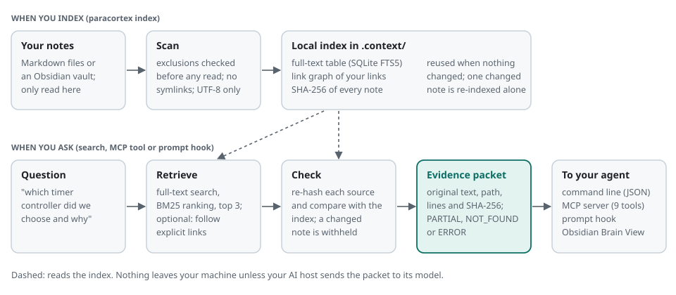

# Paracortex documentation

Paracortex gives an AI agent the original passages from your Markdown notes or
Obsidian vault, each with its file path and SHA-256 hash. The
[top-level README](../README.md) explains it in a few minutes. This page is the
map of everything else, in three parts: start using it, understand why it works
this way, and look things up.

  <picture>
    <source media="(prefers-color-scheme: dark)" srcset="img/pipeline-dark.svg">
    
  </picture>

## Start

| Read | When |
| --- | --- |
| [Quickstart](../QUICKSTART.md) | Install, index your own vault, search, connect a host, step by step |
| [Host integration](host-integration.md) | Connect Claude Code, Codex or another MCP client; the prompt hook; `doctor` and `uninstall` |
| [Starter brain and daily workflow](brain-guide.md) | Organise a new vault and give agents shared rules |
| [Context Layer is now Paracortex](RENAME.md) | Upgrading from 0.5: what changed in the rename and what keeps working |
| [0.4 to 0.5 migration](migration-0.5.md) | Upgrading from 0.4.0 |

## Theory and evidence

Read in this order for the full argument; each page also stands alone.

1. [Design rationale](design-rationale.md): every design decision, why it was
   made, and the published research it rests on.
2. [How retrieval works](retrieval.md): the query, BM25 ranking, how passages are
   cut from a note, and bounded spreading activation over your links, with a
   traced example and the trade-offs.
3. [The integrity model](integrity.md): what paths, hashes and receipts
   guarantee, how a changed note is caught and withheld, how to check a packet
   yourself, and what no hash can prove.
4. [Measurements and limits](validation.md): the sealed benchmark, the live-host
   pilots, their conditions and how to reproduce them. The benchmark itself is
   described in [bench/README.md](../bench/README.md), every look at the sealed
   cases in [bench/INSPECTIONS.md](../bench/INSPECTIONS.md), and the measurement
   harness in [eval/README.md](../eval/README.md).
5. [Privacy and threat model](privacy.md): every file the tool writes, how to
   remove it, and why vault text is treated as data, not instructions. Reporting
   a vulnerability: [SECURITY.md](../SECURITY.md).
6. [Scope and support matrix](../SCOPE.md): what is tested, what is expected but
   unverified, and what is out of scope.

## Guides by component

| Document | Component | Commands it covers |
| --- | --- | --- |
| [host-integration.md](host-integration.md) | Connecting an AI host | `mcp`, `hook`, `install`, `install print`, `uninstall`, `doctor` |
| [synapse.md](synapse.md) | Synaptic retrieval over explicit links, activation trace (full reference) | `search --method synaptic`, `graph health`, `graph suggest`, `graph_neighbors` |
| [source-lifecycle.md](source-lifecycle.md) | Source health and reversibility | `status`, `index`, `rollback` |
| [memory.md](memory.md) | Shared memory across sessions and tools | `memory add`, `list`, `resume`, `verify`, `repair`, `rebind`, `mirror`, `session` |
| [tasks.md](tasks.md) | Bounded sub-agent tasks | `tasks new`, `run`, `list`, `show`, `verify`, `cancel`, `cost`, `recover`, `ledger` |
| [subagents.md](subagents.md) | Lean sub-agent jobs and hand-back checks | `packet`, `job`, `handback`, `handoff` |
| [brain-guide.md](brain-guide.md) | Building your own brain; rules and hooks | `brain init`, `rules init/check/record`, `brief` |
| [working-records.md](working-records.md) | Note conventions for long multi-agent work: memory notes, handovers, directive logs, claim ledgers, boards | `brain init` (templates) |
| [github-context.md](github-context.md) | Optional public GitHub evidence, source management, cache and version checks | `github-context`, `github-sources`, `github-cache`, `search --github`, MCP `github_context` |
| [decisions.md](decisions.md) | Manual public or synthetic text assessment | `decisions assess` (preview by default; `--send` is explicit) |
| [responses.md](responses.md) | Manual public or synthetic task generation | `responses run` (preview by default; `--send` is explicit) |
| [api-routing.md](api-routing.md) | Offline, advisory route preview | `api plan` |
| [Obsidian Brain View](../obsidian-plugin/README.md) | The Obsidian plugin that draws the link graph and the last retrieval | - |

The experimental router has its own [router/README.md](../router/README.md).

## Reference

| Document | Contents |
| --- | --- |
| [cli.md](cli.md) | Every command's exit codes, packet statuses, packet fields and format versions |
| [eval/README.md](../eval/README.md) | Every `search` flag, and the evaluation harness |
| [CHANGELOG.md](../CHANGELOG.md) | What changed in each release |
| [ROADMAP.md](ROADMAP.md) | Proposed work that is not built yet, with the reason it waits |
| [THIRD_PARTY.md](../THIRD_PARTY.md) | Licences and notices for everything the package distributes |
| [publishing-checklist.md](publishing-checklist.md) | Maintainers: updating the repository, required checks, publication privacy, tags and reproducible artifacts |

## Three rules that hold everywhere

- **State stays in inspectable files in the vault.** Configuration, memory
  and task records use JSON, JSONL and Markdown under `.context/`; the SQLite
  search and graph indexes can be inspected and rebuilt from the source notes.
- **Retrieved text is data, never instructions.** Evidence carries
  `source_path` and `source_sha256` so a reader can check what it got.
- **Nothing is written to a host by surprise.** Every install is a dry run until
  `--apply`, backs the file up first, and is reversible with `uninstall` or by
  restoring that backup.
