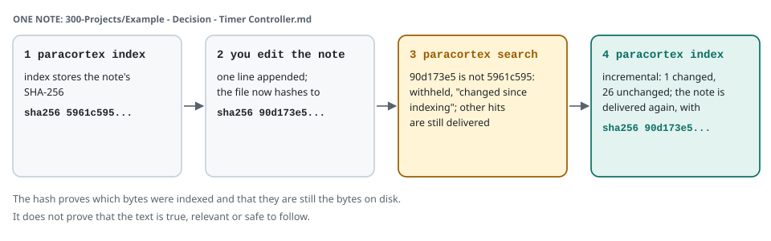

# The integrity model

Paracortex promises one narrow thing: every passage it delivers is an exact
span of a named file, and that file still has the bytes that were indexed. This
page explains how that promise is kept, how you can check it yourself, and what
it does not cover. The reference for each field and status is [cli.md](cli.md);
the day-to-day commands are in [source-lifecycle.md](source-lifecycle.md).

## Three identifiers on every passage

| Field | What it identifies | How to check it |
| --- | --- | --- |
| `source_path` | The note, relative to the vault root, as stored on disk | Open the file |
| `source_sha256` | The SHA-256 of the file's complete bytes when it was indexed | Hash the file and compare |
| `start`, `end` (and `line_start`, `line_end`) | Where the passage sits in the file, in bytes and lines | `raw[start:end]` must equal `content` |

The hash is computed over the raw bytes, not over a normalised text, so a change
of a single byte, including an invisible one, gives a different hash. SHA-256 is
used because no practical way is known to make two different files with the
same hash, so a match identifies the bytes.

## What happens at index time

`paracortex index` reads every note in scope once and records:

- the SHA-256, size and modification time of every note, in
  `.context/index-manifest.json`, a plain file you can read and diff;
- the note's text, split into records, in a SQLite FTS5 table, each record with
  its own hash and the hash of the note it came from;
- the link graph, each edge anchored to the file and line of the link;
- a format version, so a newer index is refused instead of misread.

The new index is written to a staging file. Before it replaces the live index,
SQLite's own FTS5 `integrity-check` runs on it. A build that fails leaves the
previous index untouched, and a successful build keeps the replaced one as
`.prev`, so `paracortex rollback` can restore it.

Exclusions (for example an archive folder) are checked before a file is read,
and symbolic links are never followed, so excluded text never enters the index.

## What happens at query time

Before any passage leaves the tool, the retriever opens the note again, checks
that it is still a regular file inside the vault, hashes it and compares the
hash with the index.

<p align="center">
  <picture>
    <source media="(prefers-color-scheme: dark)" srcset="img/integrity-dark.svg">
    
  </picture>
</p>

If the hashes differ, that one note is **withheld**: its text is left out, the
other passages are delivered, and the packet lists what was held back and why.
This is the real output after one line was appended to a note of the fictional
starter vault:

```json
"withheld": [
  {
    "source_path": "300-Projects/Example - Decision - Timer Controller.md",
    "reason": "changed since indexing",
    "next": "paracortex index <vault>"
  }
]
```

The command also prints one line on stderr:

```text
paracortex search: withheld 1 source(s): "300-Projects/Example - Decision - Timer Controller.md" (changed since indexing); run `paracortex index <vault>`
```

Other reasons are `deleted since indexing`, `symlink since indexing` and
`unreadable since indexing`. The empty slot is not filled with a lower-ranked
note, so after `paracortex index` the packet is the one a fresh index gives.

Why withhold instead of sending the new text: a packet that paired an old hash
with new content would be worse than no packet, because the hash would certify
text that was never checked. Why per note instead of failing the whole search:
tools such as the work log rewrite notes often, and one edited note should not
block every search.

Problems with the index itself are not hidden as an empty result. A missing
index, an unknown format, or a full-text table whose row count no longer matches
its records is an `ERROR` with a non-zero exit code, never `NOT_FOUND`.

## Check it yourself

Run this from the vault folder on any packet saved by `paracortex search`. It
uses only Python's standard library:

```python
import hashlib, json, sys
packet = json.load(open(sys.argv[1], encoding="utf-8"))
for item in packet["evidence"]:
    raw = open(item["source_path"], "rb").read()
    same_file = hashlib.sha256(raw).hexdigest() == item["source_sha256"]
    same_text = raw[item["start"]:item["end"]].decode("utf-8") == item["content"]
    print(same_file, same_text, item["source_path"])
```

On the quick-start vault, for the default search of the quick-start question,
it printed:

```text
True True 300-Projects/Example - Garden Irrigation.md
True True daily/Example - 2026-01-15.md
True True 300-Projects/Example - Decision - Timer Controller.md
```

The MCP tool `check_claims` does the same for an agent's
answer: it checks that each cited path, hash, line range and quoted span really
occurs in the vault.

## Reusing an index safely

Indexing again re-reads and re-hashes every note in scope. It never trusts size
or modification time, because both can survive a rewrite. Then it rebuilds only
what changed:

```text
incremental: 1 changed, 0 added, 0 removed, 26 unchanged (1 records rewritten)
```

and when nothing changed it leaves the index files as they are:

```text
incremental: 0 changed, 0 added, 0 removed, 27 unchanged (0 records rewritten); index unchanged
```

Incremental reuse is allowed only for the exact index generation that passed
the writer's full checks: the manifest stores the index file's SHA-256, and an
index whose digest no longer matches is rebuilt from the notes. The link graph
keeps a content digest of its own and is rebuilt the same way when it does not
match. `paracortex status` reports the index age, changed, added and deleted
notes and the files the index skipped.

Each packet also carries a `coverage` receipt: the number of indexed notes, the
SHA-256 of the index file the query read, the exact query terms and the FTS5
expression. It names no paths, so it can be logged without exposing the vault.

## What the hashes do not guarantee

- **Not truth.** A hash proves which bytes you get, not that they are correct.
- **Not relevance or sufficiency.** `PARTIAL` means evidence was found. Whether
  it answers the question is for the reader or the agent to judge.
- **Not safety.** A note can contain text shaped like instructions. Paracortex
  delivers it verbatim and marks it as data; it does not stop a model from
  following it. See the [threat model](privacy.md#threat-model-vault-content-is-data-not-instructions).
- **Not authenticity against an attacker.** Someone who can write to your vault
  can change a note and re-index it, or rewrite the index together with its
  manifest. The digests detect corruption and drift, not a hostile writer.
- **Not deletion.** The previous index generation (`.prev`) keeps the text of
  notes you later excluded or deleted until it is removed; see
  [privacy](privacy.md#deleting).

## Sources

- SQLite: FTS5 Extension (integrity-check, external content tables).
  https://www.sqlite.org/fts5.html
- NIST FIPS 180-4, Secure Hash Standard (SHA-256).
  https://csrc.nist.gov/pubs/fips/180-4/upd1/final
- The reasons behind each decision, with research sources:
  [design rationale](design-rationale.md), sections 1, 6 and 9.
