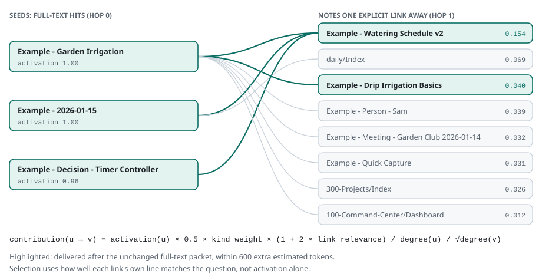
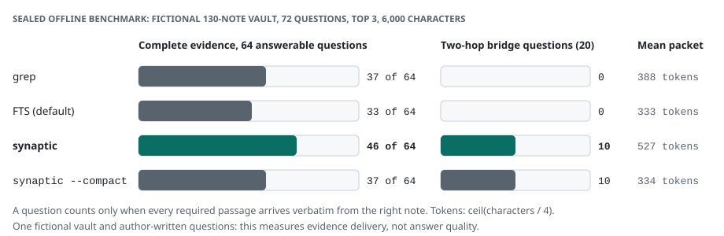

# How retrieval works

This page explains, step by step, how Paracortex turns a question into an
evidence packet: the full-text search that is the default everywhere except the
prompt hook, the way passages are cut from a note, and the opt-in method that
follows the links you wrote. It ends with the trade-offs and what has been
measured. The [design rationale](design-rationale.md) gives the reasons and the
research behind each decision; [synapse.md](synapse.md) is the complete
reference for the link method, and [cli.md](cli.md) for every packet field.

## 1. The question becomes a full-text query

The prompt is split into terms. Stopwords (such as *which*, *we*, *and*,
*why*) and repeated words are dropped. The remaining terms are quoted and joined
with `OR`. For the quick-start question the packet's `coverage` receipt records:

```json
"query_terms": ["timer", "controller", "did", "choose"],
"match_expression": "\"timer\" OR \"controller\" OR \"did\" OR \"choose\""
```

Notes and query are tokenized by the same SQLite FTS5 tokenizer,
`unicode61 remove_diacritics 2`: case and diacritics are folded, so a word
written with an accent also matches the same word without it, but there is no
stemming and no synonym list. A
word must appear in the note to match. This is the main limit of the method, and
section 4 shows how links reduce it.

## 2. Ranking: BM25 over the whole vault

Each note is stored in the index as one or more text records. FTS5 scores every
record that matches with BM25 [Robertson and Zaragoza 2009], with SQLite's fixed
parameters k1 = 1.2 and b = 0.75 [SQLite FTS5]:

```text
score(D, Q) = sum over query terms q of
              IDF(q) * f(q, D) * (k1 + 1) / ( f(q, D) + k1 * (1 - b + b * |D| / avgdl) )

IDF(q)      = log( (N - n(q) + 0.5) / (n(q) + 0.5) )
```

`f(q, D)` is how often the term occurs in the record, `|D|` the record's length,
`avgdl` the average length, `N` the number of records and `n(q)` the number that
contain the term. In words: rare terms count more than common ones, repeated
terms count with diminishing returns, and long records do not win only by being
long. A note's rank is the score of its best record. The top 3 notes are kept
(`--top-k`), ties broken by path, so the same index and question always give
the same packet.

Why BM25 and not embeddings: it is a strong baseline across very different
retrieval tasks [Thakur et al. 2021], it needs no model, no network and no
dependency beyond Python's SQLite, and its result can be explained term by term.
Plain `grep` is kept as a comparison arm in the benchmark.

## 3. Delivery: which bytes of a note are sent

A packet has a budget: 6,000 characters in total and 2,000 per note by default.
Within it, each selected note is delivered in one of these ways:

| Delivery | What is sent | Used by |
| --- | --- | --- |
| whole | the note, when it fits the per-note budget | `search`, MCP (default `window` mode) |
| `window` | the paragraph-sized blocks in which FTS5 finds query terms, most distinct terms first, at most 3 per note, neighbouring blocks merged | `search`, MCP, for longer notes |
| `focus` | only the blocks with query terms, each with its neighbour before and after in the same section, even for a short note | the prompt hook |
| `prefix` | the beginning of the note, whatever matched | comparison with 0.3 behaviour; `grep` |

Every passage is a verbatim span of the file. `start` and `end` are byte
offsets, so `raw[start:end]` is exactly the delivered `content`; `line_start`
and `line_end` give the lines; `truncated` says whether the note was cut. A
budget counts passage text only, and the packet reports its estimate as
`ceil(characters / 4)` tokens, named as an estimate in every packet.

Why windows: models use long inputs unevenly and the position of relevant text
matters [Liu et al. 2024], so a small budget should carry the part that matched,
not the note's preamble. FTS5's own `snippet()` is not used because it adds
markup, which would make the passage no longer verbatim.

## 4. Following links: bounded spreading activation (`--method synaptic`)

Some answers are split across notes. A decision note says *option 2, because of
the schedule*; the schedule itself sits in another note that shares no word with
the question. Full-text search cannot find it. The link you wrote between the
two notes can.

<p align="center">
  <picture>
    <source media="(prefers-color-scheme: dark)" srcset="img/retrieval-dark.svg">
    
  </picture>
</p>

The figure is the real trace (`.context/activation.json`) of the quick-start
question on the fictional starter vault. The method works in five steps.

1. **Link graph.** `paracortex index` also builds a graph of the explicit links
   in your notes: wikilinks, embeds, Markdown links and links declared in
   frontmatter. Each edge is anchored to the file and line where the link is
   written. A note name mentioned without a link is not an edge, and an
   ambiguous or unresolved target makes no edge (the reason is recorded).
2. **Seeds.** The notes of the full-text packet, plus up to 3 notes whose name
   or alias the prompt contains. A seed's starting activation is its BM25
   strength relative to the best hit, between 0.05 and 1; a named note starts
   at 1.
3. **Spread.** Activation flows along edges, in both directions (against the
   link direction at 0.8 of the weight), one hop by default and two at most:

   ```text
   contribution(u -> v) = activation(u) * 0.5 * kind weight * (1 + 2 * link relevance)
                          / degree(u) / sqrt(degree(v))
   ```

   `0.5` is the decay per hop. Dividing by `degree(u)` stops a note with many
   links from flooding its neighbours; dividing by `sqrt(degree(v))` stops a hub
   from collecting activation. *Link relevance* is the share of query terms on
   the line that holds the link (half that share when they appear only in its
   paragraph or section headings). A note with more than 24 neighbours is not
   expanded from; contributions below 0.005 are dropped; if a hop would
   activate more than 64 notes, that hop is not used. In the figure,
   *Watering Schedule v2* collects contributions from three seeds:
   0.0679 + 0.0611 + 0.0248, which the trace rounds to 0.1539.
4. **Decide whether to add anything.** Linked notes are added only when there is
   a reason: a link whose own line or paragraph holds the question's words, a
   note the prompt names, or text with query terms the packet does not cover
   yet. Otherwise the packet is exactly the full-text packet. In the example,
   *Drip Irrigation Basics* was added although *daily/Index* had more
   activation: the link to it sits in the list under "Status and next step",
   next to the line "Status: timer chosen, pipes not yet laid.", which holds a
   query word; the paragraph linking from *daily/Index* holds none.
5. **Add extras within a separate budget.** In the default mode the full-text
   packet is kept unchanged, byte for byte and in order, and the extras follow
   within `--extra-tokens` (600 estimated tokens by default). Every extra
   passes the same exclusion and hash checks as a search hit, never repeats
   full-text bytes, and records the path it came by (`via`, with the file and
   line of each link).

Because the full-text packet is kept and extras only follow it, synaptic search
can never deliver less complete evidence than full-text search, and its cost is
bounded by the full-text packet plus the extra budget. A property test checks
both over many generated queries. The opt-in `--compact` mode packs everything
into one smaller budget instead, and can therefore drop evidence plain search
would have carried.

Where the idea comes from: spreading activation is a model of semantic memory
from cognitive psychology [Collins and Loftus 1975] and an established
information-retrieval technique [Crestani 1997]. Left unconstrained it converges
to the same result for every query [Berthold et al. 2009], which is why seeds
from the query, decay, degree normalisation and hop and node caps are part of
the method, not tuning. The name "synaptic" is a product name: nothing learns,
no weight changes with use, and the trace records which notes were selected,
not how a model reasons.

## 5. Trade-offs

| Choice | Gain | Cost |
| --- | --- | --- |
| Lexical search, no embeddings | No model, no network, explainable, deterministic | Misses answers phrased in other words; weak for languages that need stemming |
| Verbatim windows, not summaries | Every passage checkable against the file | A window can cut context a summary would have kept |
| Explicit links only | Every edge has a file and line you wrote | Unlinked but related notes are not reached; a link is not agreement |
| Synaptic default mode keeps the full-text packet | Never less complete than full-text | More tokens: on the sealed benchmark about 58% more per packet |
| Fixed defaults, no tuning on the sealed set | Measurements stay honest | Defaults are not optimal for any particular vault |

## 6. What was measured

<p align="center">
  <picture>
    <source media="(prefers-color-scheme: dark)" srcset="img/benchmark-dark.svg">
    
  </picture>
</p>

On the sealed benchmark, synaptic search completed 13 questions that full-text
search did not, and full-text search none that synaptic did not. On two-hop
questions it completed 10 of 20; on questions about several notes at once it
gained little. These results come from one fictional vault with author-written
questions and measure evidence delivery, not answer quality. The conditions,
the live pilots and how to rerun everything are in
[Measurements and limits](validation.md) and [bench/README.md](../bench/README.md).

## References

- Berthold, M. R. et al. (2009). Pure spreading activation is pointless. CIKM.
  doi:10.1145/1645953.1646264.
- Collins, A. M., Loftus, E. F. (1975). A spreading-activation theory of semantic
  processing. Psychological Review 82(6), 407-428.
- Crestani, F. (1997). Application of Spreading Activation Techniques in
  Information Retrieval. Artificial Intelligence Review 11, 453-482.
  doi:10.1023/A:1006569829653.
- Liu, N. F. et al. (2024). Lost in the Middle: How Language Models Use Long
  Contexts. TACL. arXiv:2307.03172.
- Robertson, S., Zaragoza, H. (2009). The Probabilistic Relevance Framework: BM25
  and Beyond. Foundations and Trends in Information Retrieval 3(4), 333-389.
  doi:10.1561/1500000019.
- SQLite: FTS5 Extension, section on the bm25() function and tokenizers.
  https://www.sqlite.org/fts5.html
- Thakur, N. et al. (2021). BEIR: A Heterogeneous Benchmark for Zero-shot
  Evaluation of Information Retrieval Models. NeurIPS Datasets and Benchmarks.
  arXiv:2104.08663.

Further sources for each decision are listed in the
[design rationale](design-rationale.md#references).
